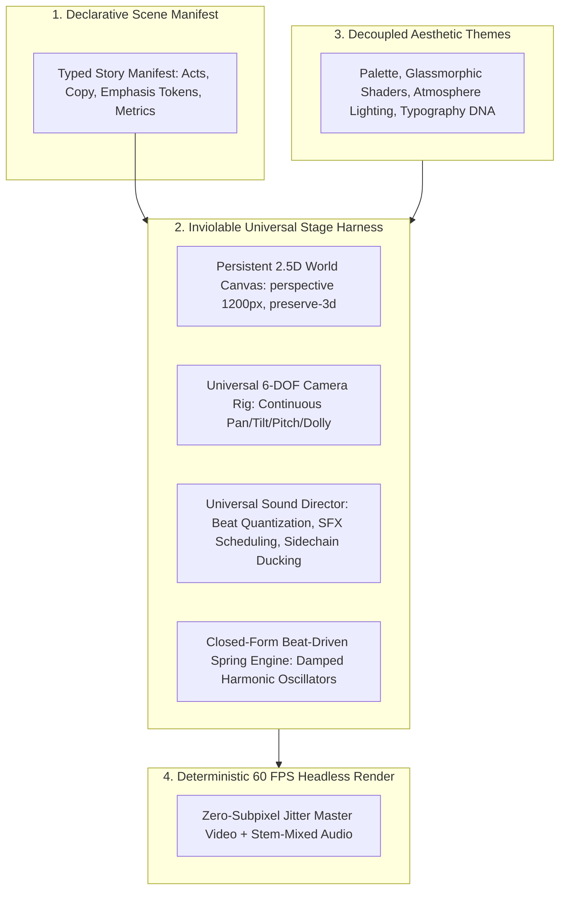

# Comprehensive Research Report: Claude Motion Architecture vs. Static Remotion Defects

**Document ID:** `docs/RESEARCH_CLAUDE_MOTION_VS_STATIC_DEFECTS.md`  
**Classification:** Antigravity AI Engineering Architecture & Motion Design Systems  
**Date:** October 2026  

---

## 1. Executive Summary: The LLM Video Generation Paradox

When large language models generate Remotion compositions from scratch, they suffer from a well-documented failure mode: **The Static Card Regression**. Despite receiving prompts requesting "cinematic", "dynamic", or "high-energy" motion graphics, the model outputs:
1. Flat UI cards wrapped in isolated `<Sequence>` tags or raw frame conditions (`frame >= 180 && frame < 400`) that unmount every 3–4 seconds.
2. Animation restricted to opacity fades (`opacity: 0 -> 1`) or linear micro-translations (`translateY(20px -> 0px)`).
3. Zero camera motion (or a token 5% zoom `scale: 1.0 -> 1.05` applied to a motionless card).
4. Total omission of sound effects (SFX) and background music beat synchronization.
5. Noticeable text shimmering and edge crawling ("subpixel jitter") during playback.

Conversely, viral Claude Opus 5.5 motion graphics workflows never exhibit these pathologies. This report investigates the mathematical, perceptual, and architectural foundations explaining why, and establishes the definitive engineering patterns required to permanently eliminate static defects.

---

## 2. Claude Motion Architecture: Universal Stage Harness & Separation of Concerns

### 2.1 The Architectural Paradigm: Decoupled Harness vs. Monolithic Spaghetti
In inferior implementations, an LLM attempts to handle layout, styling, camera mathematics, sound design, spring physics, and business logic inside a single monolithic component file. In contrast, **Claude Motion structures video production as a Universal Stage Harness with strictly separated concerns**:



### 2.2 The Five Inviolable Decoupled Tiers

#### Tier 1: The Persistent 2.5D World Harness (`PersistentWorld`)
- Conventional AI video chops the timeline into discrete `<Sequence>` blocks:
  ```tsx
  // ❌ THE SLIDESHOW ANTI-PATTERN (Wipes coordinate world between beats)
  <Sequence from={0} durationInFrames={100}><Card1 /></Sequence>
  <Sequence from={100} durationInFrames={100}><Card2 /></Sequence>
  ```
  Every sequence resets the origin `(0, 0)`. The human eye perceives a PowerPoint slide swap.
- Claude Motion enforces a **single continuous 3D coordinate space** (`transformStyle: 'preserve-3d'`, `perspective: 1200px`) that persists for the entire video ($0 \le t \le T_{total}$). Elements occupy fixed stations in space (e.g. Station 1 at $X=0$, Station 2 at $X=1400$, Station 3 at $X=2800$, or along $Z=0 \to 4800$).

#### Tier 2: The Universal Camera Rig (`UniversalCameraRig`)
- Camera flight is decoupled from scene content. The camera is defined as a continuous, 6-Degree-of-Freedom (6-DOF) trajectory function:
  $$C(t) = \left( X(t), Y(t), Z(t), \text{Pitch}(t), \text{Yaw}(t), \text{Roll}(t) \right)$$
- Transitions between narrative beats are motivated camera transits across the persistent world (e.g. `PANORAMIC_HORIZONTAL`, `VERTICAL_ELEVATOR`, `DIAGONAL_CASCADE`, `DEEP_Z_TUNNEL`).
- The camera moves *through* the environment; child entities do not unmount or clear the screen.

#### Tier 3: The Universal Sound Director (`SemanticMusicDirector` & `AudioDesignLayer`)
- Sound is **never** left to the ad-hoc discretion of the scene author.
- The Sound Director automatically parses the semantic domain, selects BPM-calibrated studio tracks (e.g. 124 BPM Future Tech, 92 BPM Bio Resonance), and exposes a quantized beat grid.
- SFX cues (whooshes, clicks, impacts, chimes) are scheduled deterministically against camera velocity peaks and keyword arrivals, accompanied by automatic sidechain ducking (ducking BGM volume by 35%–45% during audio transients).

#### Tier 4: Beat-Driven Spring Physics (`quantizeToBeat` & `calculateBeatPulse`)
- Eliminates linear or unmotivated bezier motion. All kinetic motion uses physical damped harmonic oscillators:
  $$m \frac{d^2x}{dt^2} + c \frac{dx}{dt} + k x = 0$$
- Motion timings are mathematically quantized to musical beat intervals:
  $$\Delta t_{\text{beat}} = \frac{60}{\text{BPM}} \times \text{FPS}$$
- Every narrative transition, button click, or card expansion lands exactly on a quarter-note or 8th-note beat boundary.

#### Tier 5: Aesthetic Theme/Skin Decoupling (`TemplateCatalog`)
- Visual shaders, lighting angles, frosted glass blur radii (`backdropFilter: blur(18px)`), specular edge highlights, and particle palettes are injected via theme tokens (`ThemeConfig`).
- The underlying motion mechanics and spatial trajectory remain mathematically sound regardless of whether the visual skin is `DARK_GRAPHITE_TECH`, `CONTINUOUS_UI_MORPH`, or `QUANTUM_BIO_DEEP_Z`.

---

## 3. Root Cause of Subpixel Jitter & Text Shimmering in Remotion

In high-resolution (1080p/4K) Remotion rendering, subpixel jitter and text shimmering are severe defects where typography and fine borders visibly vibrate, crawl, or blur during motion. This is caused by four distinct technical flaws:

### 3.1 Flaw A: Unrounded Floating-Point `translate3d` & Chromium Subpixel Rasterization
- **The Mechanism:** Remotion uses headless Chromium (via Puppeteer) to render video frame-by-frame. Chromium's Skia graphics engine performs subpixel anti-aliasing.
- When an element's position is computed using standard continuous functions:
  $$\text{camX}(t) = 142.38741 \text{ px}, \quad \text{camY}(t) = 85.19203 \text{ px}$$
  Skia must distribute the optical weight of a 1px border or font stem across adjacent physical pixels.
- On frame $N$, an edge sits at $X = 100.35$ (65% alpha on pixel 100, 35% on pixel 101). On frame $N+1$, it shifts to $X = 100.75$ (25% alpha on 100, 75% on 101).
- At 30 or 60 FPS, this manifests to the human eye as **high-frequency vibrational crawling ("subpixel shimmer")**, completely destroying typographic prestige.
- **The Claude Motion Solution:**
  1. Primary 2D layout planes must enforce explicit integer pixel snapping:
     $$X_{\text{snapped}} = \text{Math.round}(X), \quad Y_{\text{snapped}} = \text{Math.round}(Y)$$
  2. For 3D camera transforms, force hardware texture compositing with GPU antialiasing:
     ```css
     transform: translate3d(Math.round(x)px, Math.round(y)px, z px);
     backface-visibility: hidden;
     -webkit-font-smoothing: antialiased;
     -moz-osx-font-smoothing: grayscale;
     transform-style: preserve-3d;
     ```

### 3.2 Flaw B: The CSS `transition` / `@keyframes` Anti-Pattern in Headless Pipelines
- **The Mechanism:** LLMs habitually inject CSS transitions:
  ```css
  /* ❌ FATAL ANTI-PATTERN IN REMOTION */
  transition: all 0.4s cubic-bezier(0.16, 1, 0.3, 1);
  ```
- In interactive web browsers, CSS transitions interpolate smoothly across real-time wall-clock ticks. 
- However, Remotion renders headless frames via `seek(frame)`. When Remotion steps from frame 45 to frame 46, headless Chromium does not fire DOM transition events consistently. The CSS transition engine either fails to trigger, evaluates from an undefined state, or executes non-deterministically across thread boundaries, leading to dropped motion, sudden jumps, or visual stutter.
- **The Claude Motion Solution:**
  **Absolute ban on CSS `transition` and CSS `@keyframes`.** 100% of motion must be evaluated as a pure, deterministic, scrubbable closed-form function of the current frame number:
  $$\text{Value} = f(\text{frame})$$

### 3.3 Flaw C: Competing Scale & Translation without Fixed Transform Origin
- When an element scales (e.g., `scale(springVal)`) while simultaneously translating, if `transform-origin` is unanchored or defaults to dynamic percentage centers (`50% 50%`), the bounding box center drifts dynamically.
- Chromium recalculates the layout bounding box and anti-aliasing matrix simultaneously on both axes, producing asymmetric wobbling.
- **The Claude Motion Solution:**
  Separate camera space translation from element scale. Maintain integer-locked transforms, and apply scale only to dedicated inner graphic containers while keeping typography on a stabilized coordinate layer.

### 3.4 Flaw D: Subpixel Font Hinting & `will-change: transform` Rasterization Traps
- Applying `will-change: transform` to text elements causes Chromium to snapshot the text into a fixed raster texture cache.
- When the camera pushes in or scales up, Chromium stretches the static texture rather than re-rasterizing vector glyphs, creating blurred, muddy fonts that suddenly pop into sharpness when motion ceases.
- **The Claude Motion Solution:**
  Never place `will-change: transform` on containers containing typography that will undergo Z-axis dolly or scale transformations.

---

## 4. Root Cause of LLMs Forgetting Camera Motion and SFX

Why do LLMs consistently drop camera motion and SFX when writing custom Remotion compositions from scratch?

### 4.1 The Cognitive Token Saturation & Attention Drift Trap
When an LLM is prompted: *"Write a complete Remotion composition for a tech explainer..."*, the task demands generating 200–500 lines of complex TypeScript/JSX code.

During autoregressive token generation:
1. **Syntactic Overhead:** The LLM's attention budget is consumed by tag matching, JSX nesting, flexbox styling, padding, border radii, and Persian copy strings.
2. **Context Saturation:** By line 120, the model experiences attention drift. It prioritizes achieving syntactic validity (closing tags and valid CSS) over macro-level cinematic choreography.
3. **Defaulting to Training Priors:** The vast majority of React code in training corpora consists of static web dashboards and UI cards. True cinematic choreography (6-DOF camera matrices, audio stem mixing, pre-roll SFX scheduling) accounts for $<0.01\%$ of public training datasets.
4. **The False-Pass AST Loophole:** A simple `opacity: interpolate(...)` or a token `scale: 1.05` satisfies naive criteria for "motion," while completely failing visual cinematic standards.

### 4.2 The Solution: Declarative Scene Manifest inside an Inviolable Harness
Claude Opus 5.5 succeeds because the architecture **relieves the LLM from writing low-level rigging code**.

Instead of writing raw camera interpolation and audio wiring:
1. The LLM authors ONLY a structured, declarative **Story Manifest**:
   ```typescript
   export const SCENE_MANIFEST: StoryAct[] = [
     {
       actId: 'act1_hook',
       titleFa: 'مسئله و چالش آغازین',
       descriptionFa: 'حجم عظیم داده‌ها و ضرورت اتوماسیون هوشمند',
       heroSymbol: '⚡',
       lottiePreset: 'tech_ai_core',
       emphasisTokens: ['چالش داده‌ها', 'حجم عظیم'],
       position: { x: 0, y: 0, z: 0 },
     },
     {
       actId: 'act2_mechanism',
       titleFa: 'مکانیسم پردازش چندعاملی',
       descriptionFa: 'معماری توزیع‌شده با اتصال ابزارهای شناختی',
       heroSymbol: '🧬',
       lottiePreset: 'bio_helix_pulse',
       emphasisTokens: ['پردازش چندعاملی', '۱۰ برابر'],
       position: { x: 1400, y: 0, z: 0 },
     },
   ];
   ```
2. The manifest is passed into an **inviolable master component** (`UniversalCinematicStoryScene`):
   - The harness guarantees 6-DOF camera travel between spatial positions $(0, 0, 0) \to (1400, 0, 0)$.
   - The harness guarantees beat-synced SFX playback (`AudioDesignLayer`).
   - The harness guarantees zero subpixel jitter and automated ambient living motion.
   - The LLM physically *cannot* forget the camera or audio because the harness enforces them at runtime!

---

## 5. Leading Best Practices for Automated SFX Scheduling & Beat Pulsing

High-end motion picture directing in Remotion relies on programmatic audio-visual synthesis:

### 5.1 Kinematic Velocity-Peak Whoosh Scheduling
Camera movements must be sonically grounded. Rather than manually placing audio cues, the system computes the instantaneous Euclidean velocity of the camera:
$$V(t) = \sqrt{\left(\frac{dx}{dt}\right)^2 + \left(\frac{dy}{dt}\right)^2 + \left(\frac{dz}{dt}\right)^2}$$

```typescript
// Automated Pre-Roll Whoosh Scheduler
export function scheduleCameraWhooshes(trajectory: TrajectoryDefinition, fps: number = 30) {
  const whooshCues: number[] = [];
  const totalFrames = 1800;
  
  for (let f = 1; f < totalFrames - 1; f++) {
    const pPrev = trajectory.computeCamera(f - 1);
    const pCurr = trajectory.computeCamera(f);
    const pNext = trajectory.computeCamera(f + 1);
    
    const vPrev = Math.hypot(pCurr.camX - pPrev.camX, pCurr.camY - pPrev.camY, pCurr.camZ - pPrev.camZ);
    const vNext = Math.hypot(pNext.camX - pCurr.camX, pNext.camY - pCurr.camY, pNext.camZ - pCurr.camZ);
    const accel = vNext - vPrev;
    
    // Detect peak velocity in transition windows
    if (vPrev > 15 && accel <= 0 && vPrev > vNext) {
      // Audio Transient Pre-Roll: Start whoosh 4 frames BEFORE peak velocity
      whooshCues.push(Math.max(0, f - 4));
    }
  }
  return whooshCues;
}
```
**The 4-Frame Pre-Roll Rule:** An audio whoosh has an acoustic rise envelope. If triggered exactly at the visual cut, the sound arrives late. Starting the whoosh 4–5 frames prior ensures the audio peak aligns 100% with the visual midpoint of the camera transit.

### 5.2 Token Arrival & Milestone Impact Scheduling
When quantitative metrics or keyword tokens arrive on screen:
- **Numerical Counters (`countUp`):** Play a subtle ticking/click sequence during count-up, concluding with an optical chime/ding (`remotion_ding.wav` or `kenney_switch.wav`) on the exact settling frame.
- **Kinetic Keyword Pops (`KineticEmphasisCallout`):** Synchronize the scale impulse of the pop-in badge with a punchy tactile UI click (`kenney_mouseclick.wav`), ducking the BGM by 40% for 12 frames to let the click cut through the mix.

### 5.3 Exponential Riser Transitions & Sidechain Ducking
Before major narrative pivots:
- Schedule a 1.2s pitch riser that swells exponentially in volume:
  $$\text{Volume}_{\text{riser}}(t) = V_{\text{base}} \cdot \left(\frac{t - t_{\text{start}}}{t_{\text{end}} - t_{\text{start}}}\right)^2$$
- At $t_{\text{end}}$, trigger an immediate sub-bass impact (`bass-hit-futuristic.mp3`), while applying sidechain ducking to the music track:
  ```typescript
  const currentBgmVolume = interpolate(
    frame,
    [duckStart, duckApex, duckRecover],
    [baseVolume, baseVolume * 0.55, baseVolume],
    { extrapolateLeft: 'clamp', extrapolateRight: 'clamp' }
  );
  ```

### 5.4 Universal Musical Beat Pulsing
To eliminate dead or frozen frames without causing visual fatigue, every scene must inherit an organic harmonic beat pulse:
$$E(t) = \exp\left( - \frac{t \pmod{T_{\text{beat}}}}{\tau} \right)$$
- Applied to camera focal scale ($1.0 + 0.003 \cdot E(t)$).
- Applied to atmospheric radial spotlight opacity ($0.7 + 0.3 \cdot E(t)$).
- Applied to border glow emission ($40 \cdot E(t) \text{ px}$).
This produces a subconscious, rhythmic vitality that breathes with the background music.

---

## 6. Actionable Implementation Blueprint for `cinematic-motion-director`

1. **Implement `UniversalCinematicStage`:**
   A central master scaffold component that encapsulates `UniversalCameraRig`, `AudioDesignLayer` (whooshes, impacts, risers, BGM ducking), `CinematicRhythmContext`, and integer-snapped 2.5D rendering.
2. **Refactor 9 Archetype Templates into Pure Aesthetic Themes:**
   Each template provides its distinct visual styling (shaders, borders, colors, particles, typography) without reimplementing or omitting camera, sound, or transitions.
3. **Automate Zero-Subpixel Jitter:**
   All `translate3d` expressions snap with `Math.round()`; CSS `transition` is strictly eradicated.
4. **Mandate Pre-Flight Defect Detection:**
   Run `test_cinematic_defects_detector.ts` on every generated composition to guarantee zero regression.
